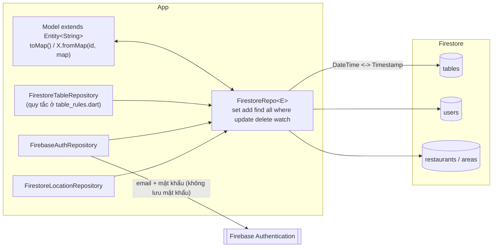

# Món Ngon Chung Lối

Ứng dụng di động (Flutter) giúp bạn **chọn món Việt và hẹn ăn cùng người khác ngay tại quán**: chọn món, xem các bàn theo giờ hẹn và số chỗ còn trống, rồi tham gia hoặc mở bàn mới. Đây **không** phải dịch vụ giao đồ ăn. Khẩu hiệu: "Món ngon • Bạn mới • Kết nối thật".

Dự án là đồ án môn Lập trình thiết bị di động. Ứng dụng chạy hoàn toàn với **dữ liệu mẫu** trong bộ nhớ (chưa có máy chủ thật), xem mục "Phần giả lập" bên dưới.

## Chức năng

- **Khám phá:** lưới 56 món, tìm kiếm không phân biệt dấu, bộ lọc buổi ăn, mục "Gợi ý cho bạn" (khẩu vị, tâm trạng, đang hot), dải "ba miền", xem tất cả món.
- **Lắc món:** nút xúc xắc vàng ở thanh trên, quay ngẫu nhiên một món (theo buổi ăn nếu có chọn), có hoạt ảnh và tôn trọng cài đặt giảm hoạt ảnh của hệ thống.
- **Chi tiết món:** mô tả, khẩu vị, tâm trạng và các bàn đang mở cho món đó.
- **Bàn ăn:** chọn khu vực, lọc theo bán kính, buổi ăn, khung giờ, ngày; thẻ bàn có số chỗ còn trống; tham gia bàn.
- **Mở bàn mới (nút +):** chọn món (tuỳ chọn), quán, ngày giờ theo khung 15 phút, thời lượng 30–120 phút, số chỗ 2–8, ghi chú; có màn xác nhận.
- **Chi tiết bàn:** thành viên (chỉ hiện khi đã đăng nhập), tham gia, rời bàn, huỷ bàn (chủ bàn), trò chuyện trong bàn (chỉ thành viên).
- **An toàn:** báo cáo bàn, người dùng, tin nhắn; chặn và bỏ chặn người dùng (bàn và tin nhắn của người bị chặn bị ẩn).
- **Hồ sơ:** "Bàn của tôi" (sắp tới / đã qua), phản hồi riêng tư, báo cáo đã gửi, danh sách chặn, đăng xuất, các trang thông tin.
- **Đăng ký giả lập:** tạo tài khoản bằng họ tên, email, mật khẩu (kiểm tra hợp lệ ngay dưới từng ô, không cho trùng email); đăng ký xong quay về màn đăng nhập với email điền sẵn, không tự đăng nhập.
- **Hai ngôn ngữ:** tiếng Việt và tiếng Anh, đổi bằng nút EN/VI ở thanh trên.
- Khách chưa đăng nhập vẫn xem, lọc và điền form; các thao tác cần quyền sẽ mở bảng đăng nhập (đăng nhập xong không tự tham gia hay tự mở bàn).

## Cài đặt và chạy

Yêu cầu: Flutter SDK (Dart ^3.13), và Chrome hoặc thiết bị/máy ảo Android.

```bash
flutter pub get

# Chạy trên Chrome
flutter run -d chrome

# Chạy trên thiết bị hoặc máy ảo Android (xem danh sách bằng: flutter devices)
flutter run -d <ma-thiet-bi>

# Đóng gói
flutter build web
flutter build apk --debug
```

## Chạy kiểm thử

```bash
flutter analyze
flutter test
```

Bộ test gồm test thuần cho các quy tắc nghiệp vụ, test repository mẫu và test giao diện (cả tiếng Việt và tiếng Anh, khổ 360/412 và chữ phóng 1,3 lần). Có test kiểm tra không còn chuỗi chữ viết cứng trong giao diện và không còn khoá chuỗi mồ côi. Danh sách kiểm thử thủ công nằm ở `docs/CHECKLIST.md`.

## Cấu trúc thư mục

```
lib/
  main.dart               điểm vào, MaterialApp, AppScope
  state/                  AppState (ChangeNotifier) và AppScope (InheritedNotifier)
  l10n/                   chuỗi chữ VI/EN (strings.dart) và hàm định dạng ngày giờ
  navigation/             khung chính và thanh dưới
  data/
    models/               model: món, bàn, quán, người dùng, tin nhắn, báo cáo...
    repositories/         các interface (abstract) và bản Mock tương ứng
    logic/                quy tắc nghiệp vụ thuần: lọc bàn, kiểm tra giờ/số chỗ, tìm không dấu...
    mock/                 dữ liệu mẫu và độ trễ giả
    mock_dishes.dart      56 món mẫu và MockDishRepository
  ui/
    theme/                màu và theme
    components/           thành phần dùng chung (thẻ món, thẻ bàn, bảng lọc, chat...)
    screens/              các màn hình
test/                     test thuần, repository và giao diện
design/                   ảnh thiết kế tham chiếu
```

## Dữ liệu mẫu và phần giả lập

Những phần sau là **giả lập để demo**, không phải dịch vụ thật:

- **Dữ liệu mẫu:** 56 món, các khu vực (Hà Nội, TP.HCM), quán, người dùng và bàn ăn được sinh trong bộ nhớ lúc mở app (giờ của bàn tính từ thời điểm hiện tại). Tên người dùng là tên giả. Người dùng đăng nhập giả lập (Minh Anh) chỉ có sẵn 2 bàn mẫu: một bàn sắp tới và một bàn đã kết thúc; có một bàn mở ở Quận 1 cố ý trùng giờ để thử lỗi trùng giờ. Mọi thay đổi mất khi tắt app.
- **Đăng nhập giả lập:** nút "Tiếp tục với Google" luôn đăng nhập thành người dùng mẫu "Minh Anh" (không dùng tài khoản Google thật, không có mật khẩu). Tài khoản mẫu không có mật khẩu nên chỉ vào bằng nút này.
- **Đăng ký giả lập:** tài khoản mới (và mật khẩu, lưu nguyên dạng chữ trong bộ nhớ vì chỉ là mô phỏng) chỉ tồn tại đến khi tắt app; **tải lại trang web là mất**. Bản thật phải dùng dịch vụ xác thực và không bao giờ lưu mật khẩu thô. Đăng nhập bằng email chỉ dùng được với tài khoản đã đăng ký trong lần chạy hiện tại.
- **Phản hồi chat tự động:** sau khi bạn gửi tin trong bàn, một thành viên khác của bàn tự trả lời bằng một câu có sẵn sau 1–2 giây (chỉ để demo, nằm trong `MockChatRepository`).
- **Độ trễ:** mỗi thao tác có độ trễ ngẫu nhiên 300–600 ms để thấy trạng thái đang tải.
- **Vị trí:** chưa dùng vị trí thật; "Cho phép vị trí" chỉ báo sẽ có ở bản sau. Khu vực chọn thủ công.
- **Ảnh món và logo:** là ô màu kèm biểu tượng tạm, chưa có ảnh thật.
- **Các trang thông tin** (Giới thiệu, Liên hệ, Chính sách quyền riêng tư, Điều khoản sử dụng): nội dung mẫu ngắn, có ghi chú trên màn. Nhóm Facebook/Threads chỉ hiện chữ, không có liên kết.
- Tên món giữ tiếng Việt ở cả hai ngôn ngữ; mô tả món có bản tiếng Anh (bản dịch tự soạn, chưa được người bản ngữ kiểm tra).

## Thay bằng API thật

Giao diện chỉ làm việc với các **interface** trong `lib/data/repositories/` (`DishRepository`, `TableRepository`, `AuthRepository`, `ChatRepository`, `SafetyRepository`, `LocationRepository`) và với `AppState`. Để nối máy chủ thật:

1. Viết lớp mới implement từng interface (ví dụ `ApiTableRepository`) gọi API hoặc Firebase, ném `TableException`/`SafetyException` với đúng mã lỗi khi vi phạm quy tắc.
2. Trong `AppState` (hàm tạo `AppState.mock` và `main.dart`), truyền các lớp mới vào thay cho bản `Mock...`.
3. Giữ các quy tắc ở `lib/data/logic/` ở phía máy chủ hoặc dùng lại; giờ của bàn được hiểu là giờ Việt Nam, bản API thật cần quy đổi trước khi trả về.
4. Việc ẩn bàn/tin nhắn của người bị chặn và quyền xem chat hiện do repository thực hiện (tham số `viewerId`), máy chủ thật cần làm tương tự.

Các bản `Mock...` vẫn dùng được cho test.

## Tổng quát hóa bằng Generics, extends, Object và Type

Các đối tượng trong app (món, quán, khu vực, người dùng, bàn, tin nhắn, báo cáo, phản hồi) đều có một **id** và một **tên hiển thị**. Thay vì mỗi lớp tự viết lại, chúng cùng kế thừa một lớp cha tổng quát:

- **Generics:** `Entity<ID>` ([lib/core/entity.dart](lib/core/entity.dart)) mô tả chung mọi đối tượng có danh tính; `ID` là kiểu của khoá nhận dạng (ở đây là `String`). `MemoryRepo<E extends Entity<ID>, ID>` ([lib/core/memory_repo.dart](lib/core/memory_repo.dart)) là kho lưu trong bộ nhớ dùng chung cho mọi `Entity`.
- **extends:** 8 lớp model (`Dish`, `Restaurant`, `Area`, `User`, `DiningTable`, `ChatMessage`, `Report`, `UserFeedback`) đều `extends Entity<String>` và chỉ giữ phần riêng của mình. `AppSettings` và `BlockEntry` không có id riêng nên không kế thừa.
- **Object:** hai hàm `describe(Object o)` và `groupByType(Iterable<Object>)` nhận **bất kỳ đối tượng nào** (kiểu `Object`), và toán tử `==` của `Entity` so sánh với một `Object`.
- **Type:** `runtimeType` (lớp thật của đối tượng lúc chạy, tương đương "Class class" của Java) được dùng để so sánh hai `Entity` (khác lớp thì không bằng nhau dù cùng id), để tính `hashCode`, để `toString`/`describe` ghi tên lớp, và để `groupByType` gom theo lớp. `MemoryRepo.kind` trả về `Type` của phần tử trong kho (ví dụ `Dish`).

### Sơ đồ lớp

```mermaid
classDiagram
  class Entity~ID~ {
    <<abstract>>
    +ID id
    +String label
    +operator ==(Object other) bool
    +hashCode int
    +toString() String
  }
  Entity <|-- Dish
  Entity <|-- Restaurant
  Entity <|-- Area
  Entity <|-- User
  Entity <|-- DiningTable
  Entity <|-- ChatMessage
  Entity <|-- Report
  Entity <|-- UserFeedback
  class MemoryRepo~E extends Entity~ID~, ID~ {
    +Type kind
    +add(E item)
    +find(ID id) E?
    +all() List~E~
    +where(test) List~E~
  }
  MemoryRepo o-- Entity : chứa
  MockLocationRepository --> MemoryRepo : khu vực, quán
  MockAuthRepository --> MemoryRepo : người dùng
```

### Lớp cha `Entity`

```dart
abstract class Entity<ID> {
  const Entity(this.id);

  final ID id;

  // Tên ngắn để hiển thị/ghi log; mỗi lớp con tự định nghĩa.
  String get label;

  @override
  bool operator ==(Object other) =>
      identical(this, other) ||
      (other is Entity<ID> && other.runtimeType == runtimeType && other.id == id);

  @override
  int get hashCode => Object.hash(runtimeType, id);

  @override
  String toString() => '$runtimeType(id: $id, label: $label)';
}
```

Hai đối tượng bằng nhau khi **cùng lớp và cùng id**, bất kể các trường khác (ví dụ một bàn sau khi thêm thành viên vẫn "là cùng một bàn").

### Ví dụ lớp con

```dart
class User extends Entity<String> {
  const User({
    required String id,
    required this.displayName,
    required this.email,
    // ...
  }) : super(id);

  final String displayName;
  final String email;

  @override
  String get label => displayName;
}
```

Tên trường và tham số công khai (`id`, `displayName`...) không đổi nên phần còn lại của app dùng như trước.

### Kho dùng chung

`MockLocationRepository` (khu vực và quán) và `MockAuthRepository` (người dùng) dùng `MemoryRepo` thay cho các vòng lặp "tìm theo id" viết lặp lại:

```dart
final MemoryRepo<Restaurant, String> _restaurants = MemoryRepo(restaurants);
_restaurants.find('q1-1');          // tìm theo id
_restaurants.kind;                  // Restaurant (kiểu Type)
describe(_restaurants.find('q1-1')!); // "Restaurant #q1-1: Quán Nhà Lá"
```

## Kết nối Firebase

Mặc định app chạy bằng dữ liệu mẫu trong bộ nhớ (Mock), không cần mạng. Có thể chuyển sang **Firebase** (đăng ký/đăng nhập thật và dữ liệu bàn ăn trên Cloud Firestore) bằng một cờ lúc chạy; test luôn dùng Mock.

```bash
# Chạy với Firebase (cấu hình nằm ở lib/firebase_options.dart)
flutter run -d chrome --dart-define=USE_FIREBASE=true
flutter run -d <ma-thiet-bi> --dart-define=USE_FIREBASE=true   # Android
```

### Việc cần làm một lần trên Firebase Console
1. **Authentication → Sign-in method:** bật nhà cung cấp **Email/Password**.
2. **Firestore Database:** tạo cơ sở dữ liệu, rồi đặt luật bảo mật (gợi ý cho đồ án, chỉ người đã đăng nhập mới được ghi):

```
rules_version = '2';
service cloud.firestore {
  match /databases/{database}/documents {
    match /{col}/{id} {
      allow read: if col in ['areas', 'restaurants', 'tables'] || request.auth != null;
      allow write: if request.auth != null;
    }
  }
}
```
3. Chạy app với `USE_FIREBASE=true`, **đăng ký rồi đăng nhập** một tài khoản, sau đó **nhấn giữ logo ở thanh trên** để đưa dữ liệu mẫu (khu vực, quán, người dùng mẫu, bàn ăn) lên Firestore. Chạy lại sẽ ghi đè và làm mới giờ của các bàn.

### Cấu trúc collection

| Collection | Document id | Lớp (ORM) | Nội dung |
|---|---|---|---|
| `users` | uid của Firebase Auth (người mới) hoặc `u1`…`u8` (người mẫu) | `User` | tên, email, ngày tạo |
| `tables` | id tự sinh (bàn mẫu: `t1`…) | `DiningTable` | món, quán, chủ bàn, giờ (Timestamp), thời lượng, số chỗ, ghi chú, trạng thái, danh sách thành viên |
| `restaurants` | `q1-1`, `hk-2`… | `Restaurant` | tên, địa chỉ, khu vực, toạ độ |
| `areas` | `hcm-q1`… | `Area` | thành phố, quận, toạ độ |

Món ăn, trò chuyện, báo cáo và danh sách chặn vẫn nằm trong bộ nhớ (Mock) ở chế độ Firebase. Đăng nhập Google chưa hỗ trợ ở chế độ Firebase (chỉ email và mật khẩu).

### ORM với Firestore Documents

Mỗi model (`extends Entity<String>`) có `toMap()` (đối tượng → Map, không gồm id) và `factory X.fromMap(id, map)` (Map → đối tượng). `FirestoreRepo<E>` ([lib/core/firestore_repo.dart](lib/core/firestore_repo.dart)) là lớp chung ánh xạ một collection với một kiểu `Entity`: ghi bằng `toMap`, đọc bằng `fromMap`, tự đổi `DateTime` ↔ `Timestamp`, có `set`, `add`, `find`, `all`, `where`, `update` (transaction), `delete` và `watch` (luồng thời gian thực).



- **Đăng ký:** tạo tài khoản ở Firebase Auth, rồi tạo document `users/{uid}` qua `FirestoreRepo<User>`, sau đó đăng xuất để quay về màn đăng nhập. Mật khẩu chỉ gửi cho Firebase, app không lưu.
- **Bàn ăn:** các quy tắc (2–8 chỗ, khung 15 phút, giờ ở tương lai, không trùng giờ, chuyển chủ bàn khi chủ rời, tự huỷ khi chỉ còn một mình) nằm ở `table_rules.dart` và được kiểm tra trước khi ghi; tham gia/rời/huỷ chạy trong transaction.
- **Lỗi:** mọi lời gọi Firebase được bọc `try/catch`. Lỗi của Firebase Auth (email đã dùng, mật khẩu yếu, sai thông tin, mất mạng, quá nhiều lần thử...) được đổi thành thông báo tiếng Việt/Anh; lỗi đọc dữ liệu hiện trạng thái lỗi kèm nút "Thử lại", không làm app sập khi mất mạng.
- **Giới hạn:** `FirestoreTableRepository.getTables` đọc cả collection rồi lọc trong bộ nhớ (đủ cho vài trăm bàn). Test dùng `fake_cloud_firestore` nên không kiểm chứng được tính nguyên tử của transaction khi nhiều người cùng ghi, chỉ kiểm chứng logic.
- Trên Windows, build Android/Windows với plugin cần bật **Developer Mode** của hệ điều hành (để tạo liên kết tượng trưng).
